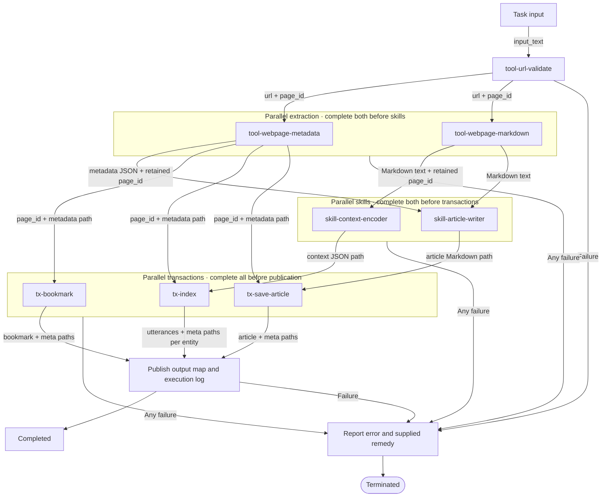

# Task flowchart

Composite boxes group parallel stages. Both extractions must succeed before either
skill starts; both skills must succeed before any transaction starts; all three
transactions must succeed before publication. Edges show data wiring, not permission
to bypass these group barriers. The orchestrator retains page_id and source paths.

Initialize the checkpoint before validation. Orchestration errors also reach error
reporting and termination. Failure paths include recording the failed attempt and
reconciling already-running work before the terminal response, per
[Failure termination](AGENTS.md#failure-termination). They never rejoin the success path.
Skills receive source contents; transactions receive file paths, with unused paths null.

The report forwards component errors/correction requests and any supplied remedy.
When none is supplied, state that rather than diagnosing the content. See the
[exact input wiring](AGENTS.md#2-wire-inputs) for field names and unused null paths.
