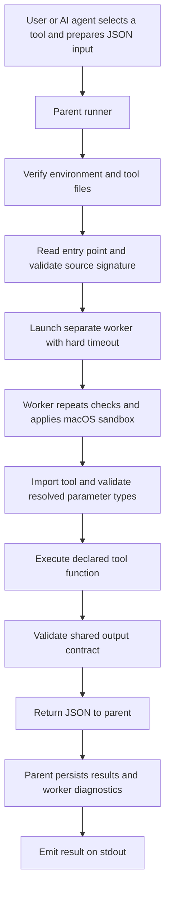

# Tools project

This project manages custom tools implemented as Python functions with explicit
input and output contracts. A user or AI agent selects a tool, supplies named
arguments as JSON, and executes it through a shared runner.

[AGENTS.md](AGENTS.md) is the policy authority. This README describes the current
architecture and design; each tool's own `AGENTS.md` documents its detailed
contract, permissions, dependencies, and side effects.

## Design

The runner owns execution infrastructure. Each tool owns its domain behavior.
The runner knows how to discover and invoke a function, enforce the common result
structure, isolate execution, and record results. It does not contain individual
tools' business rules or output field names.

Natural-language interpretation and tool selection happen outside tool functions
and outside the runner's CLI. The caller must choose a tool explicitly and supply
all required context. There is no automatic tool chaining or environment repair.

## Project layout

```text
tools/
├── AGENTS.md                    Project-wide policies and contracts
├── README.md                    Architecture and usage
├── runner.py                    Shared production execution runner
├── .venv/                       Required project Python environment
└── tool-webpage-og-crawler/
    ├── TOOL.md                  Discovery information and entry point
    ├── AGENTS.md                Detailed tool instructions and contract
    ├── tool.py                  Domain implementation
    ├── output/                  Execution payloads (<run_id>.txt)
    └── logs/
        ├── run.log              Production execution records
        └── runner.log           Python diagnostics and function timings
```

Every tool directory must be named `tool-<name>` in lowercase kebab-case, with
the complete name under 64 characters. `TOOL.md`, `AGENTS.md`, and `tool.py` are required. Additional supporting files are added only when
needed. Log files are created as their corresponding execution paths are used.

## Execution architecture



### Parent runner

[runner.py](runner.py) derives the project location from its own file, rather than
the caller's working directory. It verifies the Python environment, resolves the
selected tool beneath the project directory, and checks required files and
discovery metadata. Tool directories and required files must not be symlinks.

Before importing tool code, it parses the function's source to check named
argument binding, required annotations, and directly declared primitive input
types. Full supported parameter-type checks happen in the sandboxed worker after
import and before the function call. Semantic constraints remain in the tool.

The parent starts a separate worker using the absolute project interpreter path,
sets its working directory explicitly to `tools/`, and enforces a hard timeout.
The default is 20 seconds; `--timeout` accepts a positive value up to 300 seconds.
The parent owns persistent log writes and rechecks the shared returned structure.

### Worker

The worker verifies the environment and tool contract again, then installs the
macOS sandbox before importing tool code. It verifies denied access to unrelated project file contents, denied write access at
environment and dependency paths and denied process-fork access.

It imports the declared function dynamically, checks supplied parameter types,
and calls it with named arguments. Supported input annotations include JSON
primitive types, `Any`, unions, `Literal`, lists, dictionaries, and `TypedDict`.
Unsupported annotations fail explicitly; arguments are not coerced.

Tool prints are redirected to worker stderr to keep the JSON transport on stdout
separate. The parent captures and persists available worker diagnostics, including
diagnostics available when a worker fails or times out. Function timings use a
monotonic clock and include the invoked tool entry point.

## Tool contracts

### Discovery and callable interface

`TOOL.md` is plain Markdown without YAML frontmatter. It contains labeled `Name`,
`Description`, and `Entry point` fields, plus an `Instructions` link to the tool's
`AGENTS.md`. The declared name must match the directory name.

The existing crawler declares:

```text
Entry point: `tool.py:crawl_open_graph(url: str, raw_input: str) -> CrawlResult`
```

The function signature and types are the authoritative callable interface. Entry
points must be public, top-level synchronous functions with explicit typed named
parameters and a return annotation. Positional-only parameters, `*args`, and
`**kwargs` are not supported. Defaults and keyword-only parameters are supported.

Inputs are JSON objects whose keys correspond to parameter names. The tool's
`AGENTS.md` documents semantic constraints, defaults, expected failures, and all
tool-specific output fields.

### Shared output structure

Every tool returns a JSON-serializable object with exactly six fields:

```json
{
  "input": {
    "raw_input": "Extract metadata from https://example.com/",
    "processed_input": {"url": "https://example.com/"}
  },
  "output": "tool-webpage-og-crawler/output/<run_id>.txt",
  "output_format": "json",
  "status": "ok",
  "error": null,
  "meta_data": {"requested_url": "https://example.com/", "final_url": "https://example.com/"}
}
```

`raw_input` is a required string argument supplied explicitly by the caller;
`processed_input` records the tool arguments with defaults applied and excludes
`raw_input`. Interpretation remains outside the tools. Rejected argument values
are echoed for diagnosis rather than represented as validated.

`output` points to the selected tool’s `output/<run_id>.txt`, relative to `tools/`,
or is null on failure. `output_format` identifies its content format at the top
level: the OG tool writes JSON text (`json`); the Markdown tool writes Markdown
content directly (`markdown`). Compare mode combines nonempty variants as labeled
Markdown sections. The file is atomically replaced on success; failed runs leave
the previous result intact where possible. Different run IDs retain separate files. Repeated production inputs share an ID
and replace the same file; concurrent runs sharing an ID use last replacement wins. `meta_data` contains
other tool-specific attributes. `status` is `ok` or `error`; `error` is null on
success or exactly non-empty strings `code` and `message` on failure. Non-finite
JSON numbers are rejected. The runner enforces the envelope; tools own content
validation. Historical files and logs remain unchanged.

Expected domain failures may be returned as structured error results. Unexpected
exceptions, invalid shared output, and worker failures propagate as runner
failures. Production logs record `runner_timeout` or `runner_error` when applicable,
with `output` set to null if no accepted result is available. Pre-execution
argument rejection does not create a production execution record.

## Logging

The parent runner writes production results to `logs/run.log` and diagnostics
to `logs/runner.log` inside the selected tool's
directory. See the [shared logging contract](AGENTS.md#production-logging) for
record fields, input identifiers, and logging guarantees.

## Environment and security

The current runner requires macOS and Python 3.11 or later. Project tool execution
must use the repository-relative command `tools/.venv/bin/python -B tools/runner.py`
from the repository root, followed by `--tool` and the selected tool name. This
prefix matches `.codex/rules/tools.rules`. The runner checks that
Python is in a virtual environment and that resolved `sys.prefix` matches the
project `.venv`; shell activation alone is insufficient.

The worker sandbox blocks process fork/exec and denies writes except within a
validated tool-local `output/` directory explicitly declared by
`Output directory: output` in TOOL.md. Tools without that capability remain
read-only. Symlinks and hard-linked files in output/ are rejected. This also
protects the environment, dependency declarations, and lockfiles from worker
writes. File contents can be read only within the selected tool and required runtime
and system locations; filesystem metadata remains readable for runtime path
resolution. Network access remains permitted by the shared sandbox; tools must enforce their documented domain restrictions. The crawler,
for example, rejects non-public resolved addresses.

The virtual environment isolates dependencies; it is not itself a security
sandbox. Project policy also governs authorization and tool behavior. These
instructions and checks do not establish a tamper-proof boundary for arbitrary
hostile Python code.

Creating or changing the environment, installing dependencies, and changing
dependency configuration require separate explicit authorization. The runner
does not install packages, repair environments, or fall back to another runtime.

## Usage

All commands below start in the **parent project directory containing `tools/`**.
They assume the authorized project environment already exists. Keep the command
prefix and argument order shown below so the approval rule matches.

Run the existing crawler in production:

```sh
tools/.venv/bin/python -B tools/runner.py \
  --tool tool-webpage-og-crawler \
  --input '{"raw_input":"Extract metadata from https://example.com/","url":"https://example.com/"}'
```

For production inputs, the runner checks the selected tool's `logs/run.log` for a
previous successful execution of the same supplied input object. Matching uses
the full input, including `raw_input`, without expanding defaults; object key
order is ignored. Historical successful records without a run ID are included.
Failed executions do not trigger confirmation.

An interactive terminal asks `Run this input again? [y/N]`; only `y` or `yes`
proceeds. Non-interactive callers stop with exit code 2 and must ask the user
before retrying with `--rerun`. API callers likewise receive `DuplicateInputError`
and can pass `rerun=True` after confirmation. Declining does not execute a worker
or append a production result record. Confirmed runs retain the normal output
replacement and append-only logging behavior.

This check uses completed history; simultaneous first executions can both proceed
before either has recorded success. Unreadable or malformed history stops the
check rather than silently allowing execution.

Use `--timeout 30`, for example, to change the worker timeout.
The internal `--worker` mode is for runner orchestration.

## Adding or updating a tool

Tool creation and modification require an explicit user request. Within that
authorized scope:

1. Create or update the correctly named tool directory and its three required files.
2. Declare the capability and entry point in `TOOL.md` and the full self-contained
   contract in the tool's `AGENTS.md`.
3. Implement typed inputs, semantic validation, structured results, and the shared
   six-field envelope in `tool.py`.
4. Check naming, links, interfaces, permissions, and documentation consistency.
   Validate runtime behavior only through the project environment and runner.

A conforming new tool should not require adding its name, input fields, or output
schema to `runner.py`. The shared runner depends on project conventions and the
common contract, while domain behavior stays inside the tool directory.

## Current tools

[tool-webpage-og-crawler](tool-webpage-og-crawler/TOOL.md) fetches a public HTTP(S)
page and extracts five Open Graph properties, `keywords`, `datePublished`, and
`dateModified`. It owns URL validation, public-address checks, redirects, response
limits, HTML parsing, and JSON-LD extraction. See its
[instructions](tool-webpage-og-crawler/AGENTS.md) for exact behavior and limits.

[tool-webpage-markdown](tool-webpage-markdown/TOOL.md) extracts main article content
in balanced, precision, recall, or compare mode. Its <run_id>.txt contains Markdown directly, with labeled sections in compare mode.

Output folders use `output/`; all logs live in each tool’s `logs/` folder.
Existing artifacts were relocated without rewriting historical log records; older
records may still reference the former `outputs/` paths.

Transport JSON and result log records use compact separators. Nested type checks
retain strict validation while recording one aggregate timing per operation.
